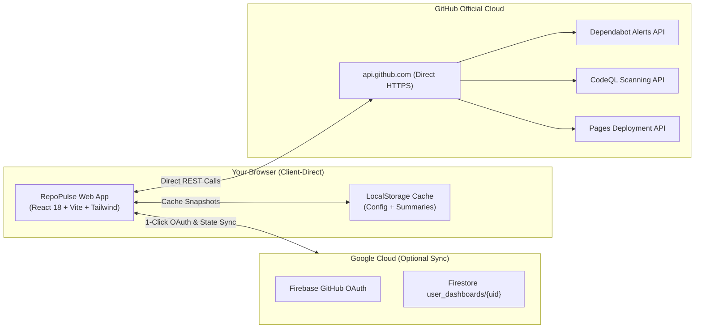

<div align="center">

# ⚡ RepoPulse

### *Your Entire GitHub Portfolio’s Health, in a Single Pulse.*

A real-time **Executive Security Wallboard & Health Operations Hub** for GitHub repositories.  
Consolidate **Dependabot CVEs**, **CodeQL static analysis flaws**, and **GitHub Pages deployment statuses** into one high-density, actionable dashboard with 1-click deep fixes.

[](https://cp099.github.io/repo-pulse/)
[](https://github.com/cp099/repo-pulse/actions/workflows/deploy.yml)
[](https://github.com/cp099/repo-pulse/security/code-scanning)
[](https://github.com/cp099/repo-pulse/security/dependabot)
[](LICENSE)
[](CONTRIBUTING.md)

<br />

<p align="center">
  <a href="https://cp099.github.io/repo-pulse/">
    
  </a>
</p>

[**🚀 Launch Web App**](https://cp099.github.io/repo-pulse/) · [**Report Bug**](https://github.com/cp099/repo-pulse/issues/new?template=bug_report.yml) · [**Request Feature**](https://github.com/cp099/repo-pulse/issues/new?template=feature_request.yml) · [**Discussions**](https://github.com/cp099/repo-pulse/discussions)

</div>

---

## 💡 Why RepoPulse?

Developers, open-source maintainers, and DevOps leads frequently manage dozens or hundreds of repositories on GitHub. Staying on top of security and deployments is broken:

- **Navigational Fatigue**: Checking Dependabot alerts requires manually opening every repository, clicking **Security**, and navigating each manifest.
- **Scattered Signals**: CodeQL static scanning alerts are buried in individual pull requests and repository settings.
- **Silent Failures**: GitHub Pages build breakdowns go unnoticed until visitors report broken sites.
- **No Wallboard View**: GitHub offers no ambient full-screen wallboard to keep on office TVs, second monitors, or check quickly on mobile.

**RepoPulse solves this in a single view.**

### 📊 GitHub Native UI vs. RepoPulse

| Feature | Standard GitHub Experience | RepoPulse ⚡ |
| :--- | :---: | :---: |
| **Multi-Repo Security Overview** | ❌ Open 50+ browser tabs | ✅ **Unified single-screen health wallboard** |
| **Executive Health Meter** | ❌ No portfolio scoring | ✅ **Real-time % clean + Grade (A/B/C/D)** |
| **Attention Radar** | ❌ Must search repository list | ✅ **Auto-surfaces only repos with Critical CVEs** |
| **Alert Inspection** | ❌ Full-page reloads per alert | ✅ **High-density accordion issue inspector** |
| **Pages Deployment Health** | ❌ Buried in repository settings | ✅ **Live stream of static site uptime & build logs** |
| **Ambient / TV Display Mode** | ❌ Not supported | ✅ **Large telemetry cards legible from across a room** |
| **Authentication Flow** | ❌ Complex token creation | ✅ **1-Click GitHub OAuth Popup** |
| **Security Architecture** | ❓ Tokens proxied through SaaS | ✅ **100% Client-Direct (Zero Intermediaries)** |

---

## ✨ Key Capabilities

### 1. 📺 Executive Wallboard (TV, Monitor & Mobile Ready)
- **Circular Health Meter**: Instant visual readout of your overall portfolio health percentage and letter grade.
- **High-Visibility Telemetry Tiles**: Extra-large numbers designed for readability on wall monitors and mobile devices.
- **Incident Attention Radar**: Automatically prioritizes and bubbles up repositories with active Critical/High CVEs or failing builds.
- **Live Pages Stream**: Instant status indicators for all your deployed GitHub Pages static sites with direct links.

### 2. 🗂️ Dedicated Repositories Ledger Sub-Page
- Filter repositories instantly by status: **All**, **Critical**, **Warnings**, **Clean**, or **GitHub Pages**.
- 4-way multi-criteria sorting: *Highest Severity*, *Most Alerts*, *Alphabetical*, or *Pages Build Status*.
- View Switcher: Toggle between a rich **Dashboard Cards Grid** and a dense **Primer Table View**.

### 3. 🔍 Full-Page Alert Detail & Accordion Inspector
- Click any repository to view a comprehensive breakdown matching GitHub's exact Primer design language.
- Accordion issues display vulnerability title, CVSS score badge, affected package, vulnerable range, and patched version.
- **1-Click Deep Links**: Jump straight into the offending line of code on GitHub or open GitHub's fix advisory.

### 4. 🔒 Zero-Intermediary / Client-Direct Security
- **No Third-Party Proxies**: All GitHub API queries run directly between your browser and `api.github.com`.
- **Zero Token Leakage**: Tokens are stored strictly in browser memory/LocalStorage and are never shared.
- **Optional Firebase Cloud Sync**: Sync your monitored repository list across devices via production Firestore rules restricted strictly to your authenticated GitHub UID (`request.auth.uid == userId`).

### 5. ⚡ Blazing-Fast & Silent Background Sync
- Silent background refresh runs periodically without distracting animations or interface interruptions.
- Built-in rate limit protection and manual refresh cooldown timer ensure you never exhaust your 5,000 req/hr GitHub API bucket.
- Split into lightweight bundles: main entry payload is just **24 kB gzipped**!

---

## 🏗️ Architecture



---

## 🚀 Quickstart

### Option A: Use the Live Web App (Zero Install)
Simply navigate to **[https://cp099.github.io/repo-pulse/](https://cp099.github.io/repo-pulse/)**, click **Connect GitHub Account (1-Click)**, and start monitoring immediately!

### Option B: Run Locally

```bash
# 1. Clone the repository
git clone https://github.com/cp099/repo-pulse.git
cd repo-pulse

# 2. Install dependencies
npm install

# 3. Start local development server
npm run dev
```

Visit `http://localhost:5173` in your browser.

---

## 🛠️ Tech Stack & Tooling

- **Core Framework**: [React 18](https://react.dev/) + [TypeScript](https://www.typescriptlang.org/)
- **Bundler & Tooling**: [Vite 6](https://vitejs.dev/) with optimized Rollup code-splitting
- **Styling & UI**: [Tailwind CSS](https://tailwindcss.com/) with GitHub Primer design tokens
- **Icons**: [Lucide React](https://lucide.dev/) (Octicon equivalent)
- **Authentication & Cloud Sync**: [Firebase 10](https://firebase.google.com/) (Modular Web SDK)
- **CI / CD Pipeline**: [GitHub Actions](https://github.com/features/actions) (`deploy.yml` + `codeql.yml`)
- **Hosting**: [GitHub Pages](https://pages.github.com/) with SPA 404 routing

---

## 🚢 Deploying Your Own Fork to GitHub Pages

1. **Fork** this repository to your GitHub account.
2. In your forked repository, navigate to **Settings** → **Pages**.
3. Under **Build and deployment** → **Source**, select **GitHub Actions**.
4. *(Optional Firebase Sync)*: In **Settings** → **Secrets and variables** → **Actions**, add your Firebase web config keys:
   - `VITE_FIREBASE_API_KEY`
   - `VITE_FIREBASE_AUTH_DOMAIN`
   - `VITE_FIREBASE_PROJECT_ID`
   - `VITE_FIREBASE_STORAGE_BUCKET`
   - `VITE_FIREBASE_MESSAGING_SENDER_ID`
   - `VITE_FIREBASE_APP_ID`
5. Push any commit to `main`. GitHub Actions will automatically compile and deploy your instance!

---

## 🛡️ Security & Privacy

RepoPulse is built with an unwavering commitment to privacy:
- Read our full [Security Policy](SECURITY.md).
- Zero tracking or advertising cookies are utilized.
- All communications are encrypted over HTTPS (`Content-Security-Policy: upgrade-insecure-requests`).

---

## 🤝 Contributing

Contributions make the open-source community thrive! Whether it's reporting a bug, proposing a new filter, or submitting a PR:

1. Review our [Contributing Guidelines](CONTRIBUTING.md).
2. Adhere to our [Code of Conduct](CODE_OF_CONDUCT.md).
3. Submit issues and feature requests using our [Issue Templates](https://github.com/cp099/repo-pulse/issues/new/choose).

---

## ⭐ Support & Stargazers

If RepoPulse saved you time or improved your GitHub security posture, please consider giving the repository a **Star ⭐**! It helps more developers discover the project.

<p align="center">
  <a href="https://github.com/cp099/repo-pulse/stargazers">
    
  </a>
  <a href="https://github.com/cp099/repo-pulse/network/members">
    
  </a>
</p>

---

## 📄 License

Distributed under the **MIT License**. See [`LICENSE`](LICENSE) for full details.

Developed with ❤️ by [Chirag P Patil](https://github.com/cp099).
