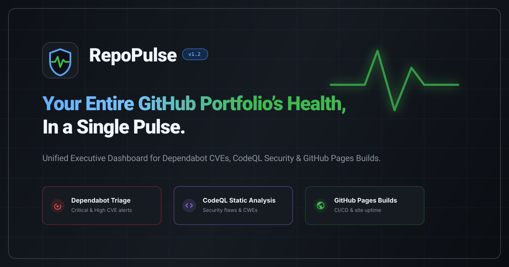
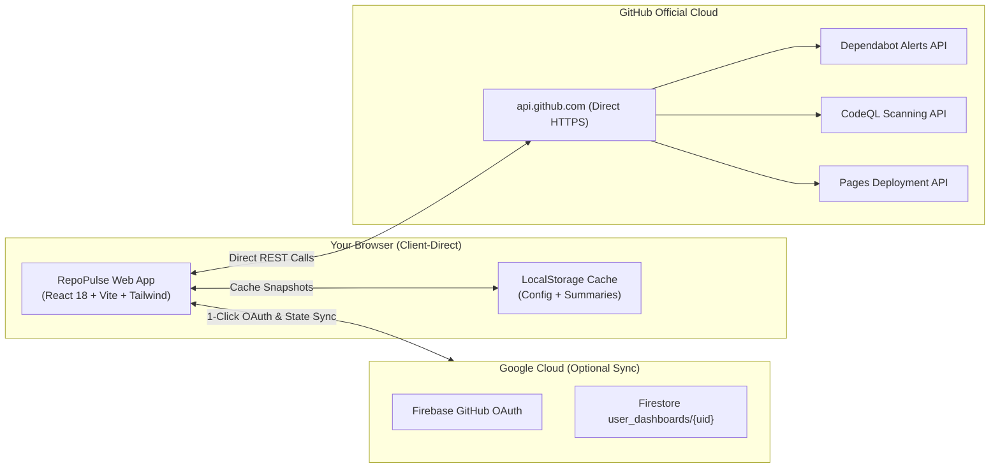

<div align="center">

# RepoPulse

### *Your Entire GitHub Portfolio’s Health, in a Single Pulse.*

A real-time **Executive Security Wallboard & Health Operations Hub** for GitHub repositories.  
Consolidate **Dependabot CVEs**, **CodeQL static analysis flaws**, and **GitHub Pages deployment statuses** into one high-density, actionable dashboard with direct links.

[](https://cp099.github.io/repo-pulse/)
[](https://github.com/cp099/repo-pulse/actions/workflows/deploy.yml)
[](https://github.com/cp099/repo-pulse/security/code-scanning)
[](https://github.com/cp099/repo-pulse/security/dependabot)
[](LICENSE)
[](CONTRIBUTING.md)

<br />

<p align="center">
  <a href="https://cp099.github.io/repo-pulse/">
    
  </a>
</p>

[**Launch Web App**](https://cp099.github.io/repo-pulse/) · [**Report Bug**](https://github.com/cp099/repo-pulse/issues/new?template=bug_report.yml) · [**Request Feature**](https://github.com/cp099/repo-pulse/issues/new?template=feature_request.yml) · [**Discussions**](https://github.com/cp099/repo-pulse/discussions)

</div>

---

## Why RepoPulse?

Developers, open-source maintainers, and DevOps leads frequently manage dozens or hundreds of repositories on GitHub. Staying on top of security and deployments presents practical challenges:

- **Navigational Overhead**: Checking Dependabot alerts requires opening every repository individually, navigating to Security, and reviewing each manifest.
- **Scattered Signals**: CodeQL static scanning alerts are distributed across individual pull requests and repository settings.
- **Silent Failures**: GitHub Pages build breakdowns often go unnoticed until reported by external visitors.
- **Lack of Wallboard View**: GitHub provides no dedicated ambient full-screen wallboard for office monitors, team screens, or quick mobile review.

**RepoPulse consolidates your portfolio into a unified view.**

### GitHub Native UI vs. RepoPulse

| Feature | Standard GitHub Experience | RepoPulse |
| :--- | :---: | :---: |
| **Multi-Repo Security Overview** | No (requires multiple browser tabs) | **Yes (unified single-screen wallboard)** |
| **Executive Health Meter** | No (no portfolio-level score) | **Yes (real-time clean percentage and grade)** |
| **Attention Radar** | No (must search repository lists) | **Yes (auto-surfaces repos with critical CVEs)** |
| **Alert Inspection** | No (full-page reloads per alert) | **Yes (high-density accordion issue inspector)** |
| **Pages Deployment Health** | No (located inside settings) | **Yes (live stream of site statuses and logs)** |
| **Ambient / TV Display Mode** | No | **Yes (large telemetry cards readable from distance)** |
| **Authentication Flow** | No (manual token configuration) | **Yes (1-click GitHub OAuth popup)** |
| **Security Architecture** | Variable (often proxied via SaaS) | **Yes (100% client-direct API communication)** |

---

## Key Capabilities

### 1. Executive Wallboard (TV, Monitor and Mobile Ready)
- **Circular Health Meter**: Instant visual readout of your overall portfolio health percentage and letter grade.
- **High-Visibility Telemetry Tiles**: Large typography formatted for readability on wall monitors and mobile devices.
- **Incident Attention Radar**: Automatically prioritizes and highlights repositories with active critical/high CVEs or failing builds.
- **Live Pages Stream**: Status indicators for all active GitHub Pages deployments with direct links.

### 2. Dedicated Repositories Ledger Sub-Page
- Filter repositories by status: **All**, **Critical**, **Warnings**, **Clean**, or **GitHub Pages**.
- Four-way multi-criteria sorting: *Highest Severity*, *Most Alerts*, *Alphabetical*, or *Pages Build Status*.
- View Switcher: Toggle between a **Dashboard Cards Grid** and a compact **Table View**.

### 3. Full-Page Alert Detail and Accordion Inspector
- Click any repository to view a comprehensive breakdown matching GitHub Primer design guidelines.
- Accordion issues display vulnerability title, CVSS score badge, affected package, vulnerable range, and patched version.
- **Direct Navigation**: Jump straight to the offending line of code on GitHub or open GitHub's fix advisory.

### 4. Zero-Intermediary and Client-Direct Security
- **No Third-Party Proxies**: All GitHub API queries run directly between your browser and `api.github.com`.
- **Zero Token Leakage**: Tokens are stored strictly in browser memory/LocalStorage and are never shared.
- **Optional Firebase Cloud Sync**: Sync your monitored repository list across devices via production Firestore rules restricted strictly to your authenticated GitHub UID (`request.auth.uid == userId`).

### 5. High-Performance and Silent Background Sync
- Silent background refresh runs periodically without interface interruptions.
- Built-in rate limit protection and manual refresh cooldown timer ensure you remain within the 5,000 req/hr GitHub API quota.
- Optimized bundle splitting: main entry payload is **24 kB gzipped**.

---

## Architecture



---

## Quickstart

### Option A: Use the Live Web App (Zero Install)
Navigate to **[https://cp099.github.io/repo-pulse/](https://cp099.github.io/repo-pulse/)**, click **Connect GitHub Account**, and start monitoring immediately.

### Option B: Run Locally

```bash
# 1. Clone the repository
git clone https://github.com/cp099/repo-pulse.git
cd repo-pulse

# 2. Install dependencies
npm install

# 3. Start local development server
npm run dev
```

Visit `http://localhost:5173` in your browser.

---

## Tech Stack and Tooling

- **Core Framework**: [React 18](https://react.dev/) and [TypeScript](https://www.typescriptlang.org/)
- **Bundler and Tooling**: [Vite 6](https://vitejs.dev/) with Rollup code-splitting
- **Styling and UI**: [Tailwind CSS](https://tailwindcss.com/) with GitHub Primer design tokens
- **Icons**: [Lucide React](https://lucide.dev/) (Octicon equivalent)
- **Authentication and Cloud Sync**: [Firebase 10](https://firebase.google.com/) (Modular Web SDK)
- **CI / CD Pipeline**: [GitHub Actions](https://github.com/features/actions) (`deploy.yml` and `codeql.yml`)
- **Hosting**: [GitHub Pages](https://pages.github.com/) with SPA 404 routing

---

## Deploying to GitHub Pages

1. **Fork** this repository to your GitHub account.
2. In your forked repository, navigate to **Settings** -> **Pages**.
3. Under **Build and deployment** -> **Source**, select **GitHub Actions**.
4. *(Optional Firebase Sync)*: In **Settings** -> **Secrets and variables** -> **Actions**, add your Firebase web config keys:
   - `VITE_FIREBASE_API_KEY`
   - `VITE_FIREBASE_AUTH_DOMAIN`
   - `VITE_FIREBASE_PROJECT_ID`
   - `VITE_FIREBASE_STORAGE_BUCKET`
   - `VITE_FIREBASE_MESSAGING_SENDER_ID`
   - `VITE_FIREBASE_APP_ID`
5. Push any commit to `main`. GitHub Actions will automatically compile and deploy your instance.

---

## Security and Privacy

RepoPulse is built with client-side security principles:
- Read our full [Security Policy](SECURITY.md).
- Zero tracking or advertising cookies are utilized.
- All communications are encrypted over HTTPS (`Content-Security-Policy: upgrade-insecure-requests`).

---

## Contributing

Contributions make the open-source community thrive. To contribute:

1. Review our [Contributing Guidelines](CONTRIBUTING.md).
2. Adhere to our [Code of Conduct](CODE_OF_CONDUCT.md).
3. Submit issues and feature requests using our [Issue Templates](https://github.com/cp099/repo-pulse/issues/new/choose).

---

## Support and Community

If RepoPulse saved you time or improved your GitHub security posture, please consider starring the repository. It helps other developers discover the project.

<p align="center">
  <a href="https://github.com/cp099/repo-pulse/stargazers">
    
  </a>
  <a href="https://github.com/cp099/repo-pulse/network/members">
    
  </a>
</p>

---

## License

Distributed under the **MIT License**. See [`LICENSE`](LICENSE) for details.

Maintained by [Chirag P Patil](https://github.com/cp099).
